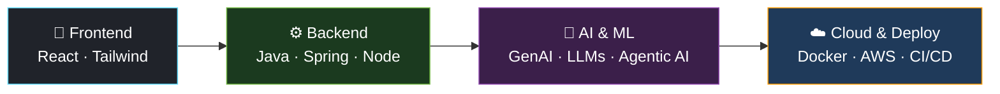

<!-- ============ HEADER ============ -->
<div align="center">


<a href="https://github.com/Srinivas14aiml">
  
</a>

<br/><br/>

<a href="https://srinivas14aiml.github.io/Srinivas-portfolio/"></a>
<a href="https://www.linkedin.com/in/srinivas-devalla-22305328b/"></a>
<a href="mailto:devallasrinivas14@gmail.com"></a>
<a href="https://srinivas14aiml.github.io/Srinivas-portfolio/resume.pdf"></a>

<br/><br/>


</div>

---

## ⚡ Who I Am

> I build **scalable full-stack systems** and **intelligent AI products**, from QR-secured attendance engines to climate-forecasting ML platforms. I lead the **HackSpace Club** at **Anurag University**, running national hackathons for 100+ student contributors.

```yaml
name:        Srinivas Devalla
role:        Full-Stack AI & ML Engineer
leadership:  President, HackSpace Club (Anurag University)
education:   B.Tech, Artificial Intelligence & Machine Learning (2023 – 2027)
core_stack:  [Java, Spring Boot, React, Node.js, Python, PostgreSQL, MongoDB]
ai_focus:    [Machine Learning, Agentic AI, NLP, LLMs & Transformers, Generative AI]
achievements:
  - Top Performer, VISIONAVA 2K25 National Hackathon
  - Runner-Up, Cognizant Technoverse Hackathon 2026
  - Finalist project at TEJAS 2K26 Project Expo
  - NPTEL IIT Kharagpur ML: Elite certified (22.92 / 25)
status:      🟢 Open to opportunities (graduating 2027)
```

---

## 🏆 Achievements at a Glance

<div align="center">

| 🥇 | Achievement | Detail |
|:-:|---|---|
| 🏅 | **VISIONAVA 2K25** | Top Performer, national hackathon. Gen-AI academic assistant chatbot |
| 🥈 | **Cognizant Technoverse 2026** | Runner-Up. Healthcare 30-day readmission prediction with SHAP explainability |
| 🌍 | **TEJAS 2K26 Expo** | ClimaCore, IoT + ML microclimate forecasting platform |
| ☁️ | **Azure AI InnoQuest** | ClinicOps Analysis, hospital operations intelligence |
| 👑 | **HackSpace Club** | President leading 100+ contributors and flagship hackathons |
| 🎓 | **NPTEL × IIT Kharagpur** | Machine Learning, Elite certification |

</div>

---

## 🛠️ Tech Arsenal

<div align="center">


</div>

### 🗺️ Engineering Roadmap



---

## 🚀 Featured Projects

<table>
<tr>
<td width="50%" valign="top">

### 🔐 QR Attendance System
`Java Spring` `PostgreSQL` `REST APIs` `JWT`

Scalable attendance validation engine with **session-based dynamic QR tokens**, **JWT cryptographic security**, role-based access control and PostgreSQL persistence.

[💻 Backend](https://github.com/Srinivas14aiml/QR_Attendance_System_Backend) · [🎨 Frontend](https://github.com/Srinivas14aiml/QR_Attendance_System_Frontend)

</td>
<td width="50%" valign="top">

### 🌍 ClimaCore: AI Climate Intelligence
`Python` `XGBoost` `Random Forest` `Streamlit` · 🏅 *TEJAS 2K26 Expo*

IoT and ML microclimate forecasting. Ingests sensor telemetry and predicts **floods, heatwaves and air pollution**, with a real-time AQI dashboard and recommendations for farmers and smart-city planning.

[🌐 Portfolio](https://srinivas14aiml.github.io/Srinivas-portfolio/)

</td>
</tr>
<tr>
<td width="50%" valign="top">

### 🏥 Healthcare Readmission Predictor
`Scikit-Learn` `SHAP` `FastAPI` · 🥈 *Cognizant Technoverse Runner-Up*

Predicts **30-day hospital readmissions** and uses **SHAP values** for model explainability, powering clinician decision-support dashboards.

[🌐 Portfolio](https://srinivas14aiml.github.io/Srinivas-portfolio/)

</td>
<td width="50%" valign="top">

### 🩺 ClinicOps Analysis
`TypeScript` `Azure AI` `Node.js` · ☁️ *Azure AI InnoQuest*

Hospital operations intelligence suite analysing **bed occupancy, emergency triage congestion** and patient trajectory optimisation.

[💻 View Code](https://github.com/Srinivas14aiml/clinicops_analysis)

</td>
</tr>
<tr>
<td width="50%" valign="top">

### 🤖 Student AI Chatbot
`MongoDB` `Express` `Node.js` `NLP` · 🏅 *VISIONAVA 2K25 Top Performer*

MEAN-stack campus assistant with **NLP classifiers** that autonomously resolves student and lecturer queries from college documents.

[💻 View Code](https://github.com/Srinivas14aiml/student_chatbot_with_mean)

</td>
<td width="50%" valign="top">

### 📍 Loc8r: Location Review Platform
`Node.js` `Express` `MongoDB` `Leaflet`

Location-based cafe and workspace discovery with **geo-spatial MongoDB indexing** and real-time distance sorting.

[💻 View Code](https://github.com/Srinivas14aiml/loc8r)

</td>
</tr>
</table>

<div align="center">

[](https://github.com/Srinivas14aiml?tab=repositories)

</div>

---

## 👑 Leadership: President, HackSpace Club

Driving technical culture, national hackathons and AI engineering initiatives at **Anurag University** with **100+ active student contributors**.

| Event | Role / Scale |
|---|---|
| ⚔️ **HACKWAR 2026** | Flagship 24-hour national hackathon across AI, Web3 and Cloud tracks, with cash rewards |
| 🚀 **AVINYA 2K25** | Led the organising committee for 100+ cross-university teams, ₹1.5 Lakh+ in prizes |
| 🧪 **VISIONOVA 2.0 2K26** | National Coordinator for a 24-hour hackathon across HealthTech, AgriTech, FinTech and LegalTech |

---

## 💼 Experience & Training

| Period | Program | Highlights |
|---|---|---|
| **Jun 2026** | ⚙️ **ServiceNow Virtual Internship** | Agentic AI, Flow Designer, Automated Test Framework |
| **Jan – Feb 2025** | 🏢 **Deloitte Data Analytics Simulation** | Forensic technology, fraud detection and risk assessment, Power BI visualisation |
| **2024 – 25** | 🧠 **Code Alpha AI Internship** | Hands-on AI projects including a language translation tool and FAQ chatbot |
| **2024 – 25** | 🔬 **Edunet Foundation (ACITE & Shell)** | 4-week AI internship |
| **Simulation** | 📈 **PwC Power BI Job Simulation** | Data visualisation and business insights |

---

## 📜 Verified Certifications

<div align="center">

| | | |
|:-:|:-:|:-:|
| ☁️ **AWS Academy**<br/>Cloud Foundations (20 hrs) | 🎓 **NPTEL IIT Kharagpur**<br/>Machine Learning, Elite (22.92/25) | ⚙️ **ServiceNow**<br/>Virtual Internship, Agentic AI |
| 🤖 **Salesforce**<br/>Agentblazer Champion | 🛡️ **Zscaler**<br/>Cybersecurity EDU-102, Zero Trust | 🐍 **IBM**<br/>Data Analysis with Python |
| 🏢 **Deloitte**<br/>Data Analytics Simulation | 📈 **PwC**<br/>Power BI Simulation | 🏆 **Cognizant**<br/>Technoverse Hackathon 2026 |

</div>

---

## 🎓 Education

| Institution | Program | Years |
|---|---|---|
| **Anurag University** | B.Tech, Artificial Intelligence & Machine Learning | 2023 – 2027 |
| **Bhashyam Junior College** | Intermediate | 2020 – 2022 |

---

## 📊 GitHub Analytics

<div align="center">


<br/>


<br/>


<br/>


</div>

---

## 🤝 Let's Build Something Exceptional

I'm looking for **AI/ML, full-stack and software engineering roles** where I can ship real products and keep learning fast.

<div align="center">

📧 [devallasrinivas14@gmail.com](mailto:devallasrinivas14@gmail.com) &nbsp;·&nbsp; 💼 [LinkedIn](https://www.linkedin.com/in/srinivas-devalla-22305328b/) &nbsp;·&nbsp; 🌐 [Portfolio](https://srinivas14aiml.github.io/Srinivas-portfolio/) &nbsp;·&nbsp; 📞 +91 8125678184

<br/>


</div>
